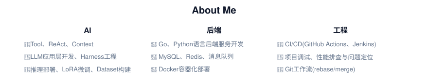

  
  <!-- 打字机效果 -->
  
  
  
    
  

  

<picture>
  <source media="(prefers-color-scheme: dark)" srcset="./assets/about-en-dark.svg">
  
</picture>
<picture>
  <source media="(prefers-color-scheme: dark)" srcset="./assets/heading-tech-dark.svg">
  
</picture>

  
  
  
  
  
  
  
  
  
  
  

  

<picture>
  <source media="(prefers-color-scheme: dark)" srcset="./assets/heading-contrib-en-dark.svg">
  
</picture>

<picture>
  <source media="(prefers-color-scheme: dark)" srcset="https://raw.githubusercontent.com/Flandern1211/Flandern1211/output/github-snake-dark.svg" />
  <source media="(prefers-color-scheme: light)" srcset="https://raw.githubusercontent.com/Flandern1211/Flandern1211/output/github-snake.svg" />
  
</picture>

<picture>
  <source media="(prefers-color-scheme: dark)" srcset="./assets/thanks-en-dark.svg">
  
</picture>
