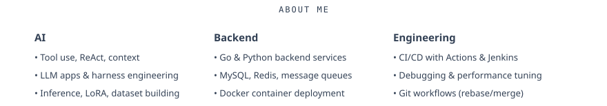

  
  <!-- Typing effect -->
  <picture>
    <source media="(prefers-color-scheme: dark)" srcset="https://readme-typing-svg.demolab.com?font=Fira+Code&weight=600&size=18&duration=2000&pause=500&color=cbd5e1&center=true&vCenter=true&width=600&lines=AI+Application+Developer+%7C+Backend+Engineer;Agent+%26+RAG+Architecture+in+Practice;LLM+Fine-tuning+%26+Production+Deployment;Stay+curious%2C+ship+high-quality+projects">
    
  </picture>
  

    <a href="mailto:31@gmail.com"><picture>
      <source media="(prefers-color-scheme: dark)" srcset="./assets/v4/contact-dark.svg">
      
    </picture></a>
  

  

<picture>
  <source media="(prefers-color-scheme: dark)" srcset="./assets/v4/about-dark.svg">
  
</picture>
<picture>
  <source media="(prefers-color-scheme: dark)" srcset="./assets/v4/tech-dark.svg">
  
</picture>
<picture>
  <source media="(prefers-color-scheme: dark)" srcset="./assets/v4/heading-contrib-dark.svg">
  
</picture>

<picture>
  <source media="(prefers-color-scheme: dark)" srcset="https://raw.githubusercontent.com/Flandern1211/Flandern1211/output/github-snake-dark.svg" />
  <source media="(prefers-color-scheme: light)" srcset="https://raw.githubusercontent.com/Flandern1211/Flandern1211/output/github-snake.svg" />
  
</picture>

<picture>
  <source media="(prefers-color-scheme: dark)" srcset="./assets/v4/thanks-dark.svg">
  
</picture>